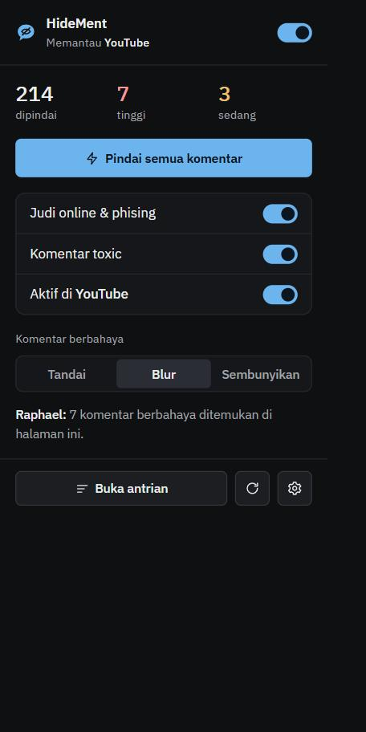
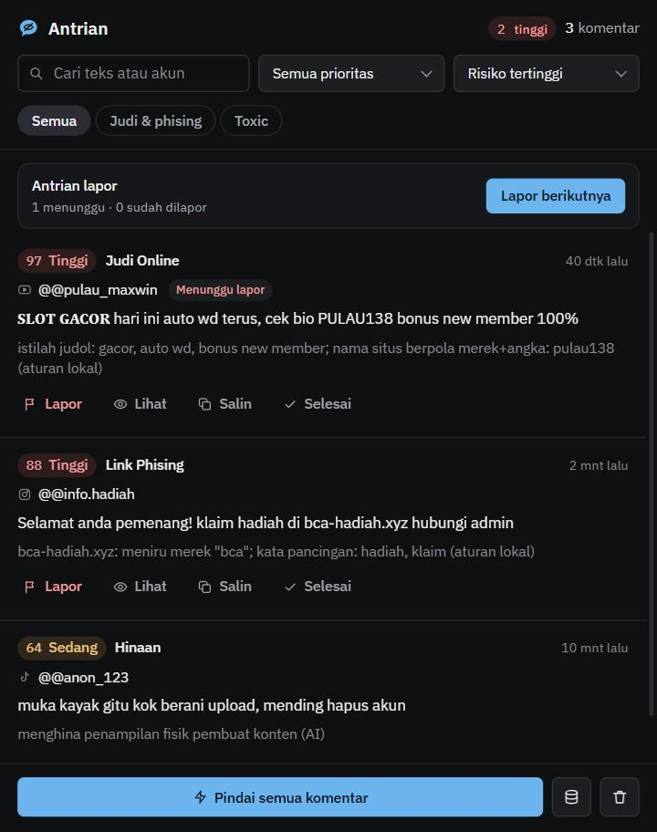
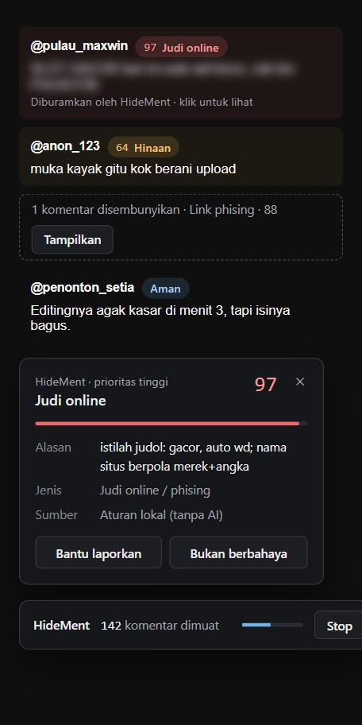
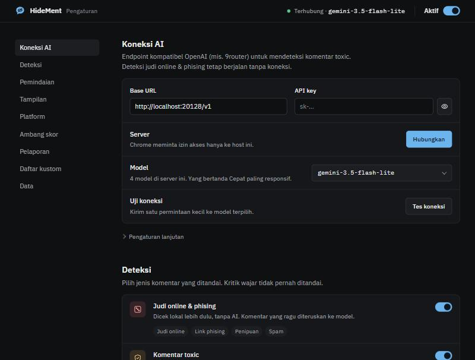

### HideMent
**Hide Comment — sembunyikan komentar berbahaya, biarkan diskusi tetap hidup.**

Ekstensi browser untuk mendeteksi dan menyembunyikan promosi judi online (judol), link phising, ujaran kebencian, pelecehan seksual, penistaan agama, dan SARA berbahasa Indonesia.

`Chrome / Edge (MV3)` · `YouTube` · `Instagram` · `TikTok` · `X` · `MIT`

<br clear="left"/>

---

> **«Jawaban»** Analisis komentar dimulai. Aturan lokal dijalankan lebih dulu; hanya komentar yang ambigu yang diteruskan ke model AI.
> — *Raphael, sistem analisis HideMent*

## Daftar isi

- [Tentang HideMent](#tentang-hidement)
- [Raphael: sistem di balik HideMent](#raphael-sistem-di-balik-hidement)
- [Fitur](#fitur)
- [Tampilan](#tampilan)
- [Persyaratan](#persyaratan)
- [Instalasi](#instalasi)
- [Konfigurasi](#konfigurasi)
- [Penggunaan](#penggunaan)
- [Privasi & keamanan](#privasi--keamanan)
- [Pengembangan](#pengembangan)
- [Riset & evaluasi](#riset--evaluasi)
- [Troubleshooting](#troubleshooting)
- [Roadmap](#roadmap)
- [Kredit & atribusi](#kredit--atribusi)
- [Lisensi](#lisensi)

## Tentang HideMent

Kolom komentar media sosial Indonesia dipenuhi:

- **Promosi judi online** yang disamarkan dengan huruf hias (`𝐒𝐋𝐎𝐓 𝐆𝐀𝐂𝐎𝐑`), nama situs merek+angka (`PULAU138`), atau ajakan "cek bio".
- **Link phising dan penipuan** yang meniru bank, e-wallet, atau platform.
- **Perundungan dan hinaan**, termasuk **sarkasme** yang tidak tertangkap filter kata kasar biasa.

Jumlahnya terlalu banyak untuk diperiksa manual, sementara filter sederhana justru ikut menandai kritik yang wajar.

HideMent **tidak** bertujuan menghapus semua komentar negatif. Tujuannya:

1. **Mengurangi komentar yang benar-benar merugikan** pengguna dan kreator.
2. **Tetap membiarkan kritik normal.** "Editingnya jelek" atau "argumennya lemah" adalah kritik, bukan serangan.
3. **Membantu moderator memprioritaskan** lewat skor risiko 0–100.
4. **Mempermudah pelaporan** dengan saran alasan laporan. Keputusan akhir tetap di tangan manusia.

## Raphael: sistem di balik HideMent

Raphael adalah nama sistem analisis HideMent. Ia yang "berbicara" lewat kotak pesan di popup, Pengaturan, dan Dashboard Antrian, dan ia menjalankan pipeline berikut untuk setiap komentar:

```
Komentar terlihat di layar (atau dimuat oleh Pindai Cepat)
        │
        ▼
Normalisasi teks ─── huruf hias, leetspeak (g4c0r), spasi (s l o t), huruf Kiril tiruan, zero-width
        │
        ▼
Aturan lokal (tanpa API) ── judol & phising yang jelas langsung ditandai
        │ sisanya
        ▼
Cache ── komentar yang sama tidak dinilai dua kali
        │ yang baru
        ▼
Model AI (endpoint kompatibel OpenAI) ── batch kecil, paralel, jawaban streaming per baris
        │
        ▼
Badge · highlight · blur · sembunyikan · Dashboard Antrian
```

Kenapa efisien:

- **Judol yang jelas tidak pernah dikirim ke AI.** Aturan lokal menangkapnya dalam hitungan mikrodetik.
- **Cache** (hingga 3.000 entri per sesi browser) mencegah komentar identik dinilai ulang.
- **Batch + streaming**: komentar dikirim berkelompok (default 8 per request, 4 request paralel) dan hasilnya diproses baris per baris, jadi badge muncul satu per satu tanpa menunggu seluruh batch.
- **Hanya komentar yang terlihat** yang dianalisis saat mode scroll biasa (IntersectionObserver), kecuali kamu menjalankan Pindai Cepat.

## Fitur

**Enam mode deteksi**, dipilih lewat checkbox (bawaan hanya Judol yang aktif):

| Mode | Yang dideteksi |
|---|---|
| **Judol** | judi online, link phising, penipuan (hadiah palsu, investasi bodong, pinjol), spam |
| **Ujaran Kebencian** | hinaan, perundungan, ancaman, sarkasme yang merendahkan |
| **Pelecehan Seksual** | komentar cabul/mesum ke seseorang, objektifikasi tubuh, ajakan seksual |
| **Penistaan Agama** | menghina ajaran, kitab suci, nabi/tokoh suci, simbol, atau ibadah suatu agama |
| **SARA** | kebencian/hasutan terhadap kelompok berdasarkan suku, ras, etnis, penganut agama, antargolongan |
| **Kustom** | apa pun yang kamu definisikan sendiri dengan kalimat biasa (mis. spoiler, promosi akun tertentu) |

Judol dicek lokal tanpa AI; mode lainnya butuh koneksi AI.

**Contoh belajar AI**: tambahkan komentar berlabel (manual, impor JSON Lines/JSON/CSV, atau otomatis dari tombol "Bukan berbahaya"). Setiap analisis, HideMent mengambil sampai 8 contoh yang paling mirip (kemiripan trigram, tahan huruf hias & angka pengganti) dan mengirimnya ke AI sebagai acuan. Tidak ada training; jalan di model apa pun.

**Fitur lainnya:**

- **Dua metode pemindaian**: *Scroll biasa* (dianalisis saat terlihat) atau **Pindai Cepat**, yang otomatis memuat semua komentar sebuah postingan termasuk balasannya.
- **Badge + skor risiko** (Tinggi / Sedang) di samping komentar, lengkap dengan alasannya.
- **Tandai, blur, atau sembunyikan**, bisa diatur per kategori. Komentar yang diblur bisa dibuka dengan klik.
- **Dashboard Antrian** di side panel: komentar berbahaya dari semua tab, diurutkan dari risiko tertinggi, bisa difilter, dicari, dan diekspor ke CSV.
- **Lapor semi-otomatis** (opsional): HideMent membuka menu ⋯, mengklik "Laporkan", memilih alasan dan sub-alasan, lalu **berhenti di tombol Kirim**. Tombol kirim selalu ditekan pengguna, supaya salah deteksi tidak melaporkan orang yang tidak bersalah dan akun pengguna tidak dianggap melakukan laporan massal.
- **Whitelist** akun tepercaya dan **kata kunci judol kustom**.
- **Tombol "Bukan berbahaya"** untuk mencatat salah deteksi sebagai data riset (bisa diekspor ke JSON).
- **Tetap berguna tanpa AI**: deteksi judol & phising berbasis aturan lokal berjalan tanpa API key.

## Tampilan

| Popup | Dashboard Antrian | Overlay di halaman |
|---|---|---|
|  |  |  |



> Tangkapan layar memakai data contoh sintetis.

Gayanya alat utilitas yang tenang: abu netral, satu aksen biru "Tempest" yang dipakai hemat (unsur Rimuru yang halus, bersama logo gelembung berbentuk slime), serta merah dan kuning hanya untuk tingkat bahaya. Huruf memakai IBM Plex Sans & Mono yang dibundel di dalam ekstensi. Overlay di halaman platform memakai font sistem agar tidak ada aset ekstensi yang terekspos ke situs.

Semua kontrol adalah komponen vanilla JS yang bisa dipakai penuh dengan keyboard: saklar (`role="switch"`), dropdown kustom (panah, Home/End, ketik-untuk-mencari), pemilih model dengan kolom cari, grup pilihan dengan navigasi panah, slider ambang ganda, dan dialog konfirmasi yang mengembalikan fokus. Tata letaknya responsif dari lebar HP (375 px) sampai desktop.

## Persyaratan

| Kebutuhan | Keterangan |
|---|---|
| Browser | Chrome atau Edge **116+** (Manifest V3, side panel) |
| Node.js | **18+** untuk build (diuji dengan Node 26) |
| Endpoint AI *(opsional)* | Server yang kompatibel dengan OpenAI (`/v1/models` dan `/v1/chat/completions`), mis. 9router (dipakai proyek ini), OpenRouter, atau server lokal |

## Instalasi

```bash
git clone https://github.com/MyKineID/HideMent.git
cd HideMent
npm install
npm run build
```

1. Buka `chrome://extensions` (atau `edge://extensions`).
2. Aktifkan **Developer mode**.
3. Klik **Load unpacked**, lalu pilih folder `dist/`.
4. Halaman Pengaturan terbuka otomatis saat pertama kali dipasang.

## Konfigurasi

Semua pengaturan ada di halaman **Pengaturan** (ikon roda gigi di popup):

1. **Koneksi AI**: isi **Base URL** (mis. `http://localhost:20128/v1`) dan **API key**, klik **Hubungkan**. Chrome akan meminta izin akses hanya ke host tersebut.
2. **Model**: pilih model dari daftar. Model bertanda **CEPAT** (keluarga flash/lite) paling responsif.
3. **Uji**: klik **Tes koneksi** untuk memastikan model merespons.

Pengaturan lanjutan:

| Opsi | Default | Rentang |
|---|---|---|
| Timeout | 30 dtk | 5–180 dtk |
| Komentar per request | 8 | 1–50 |
| Request paralel | 4 | 1–8 |
| Batas Pindai Cepat | 300 komentar | 50–2000 |
| Ambang Sedang / Tinggi | 50 / 80 | 10–100 |

Nilai di luar rentang otomatis dikoreksi saat dimuat, jadi data pengaturan yang rusak tidak bisa membuat pemindaian macet.

### Model yang disarankan

Hasil `npm run bench` dari proyek asal (20 komentar, Oktober 2026):

| Model | Hasil pertama | Total | Berbahaya vs aman | Kategori |
|---|---|---|---|---|
| `gemini-3.1-flash-lite-preview` | 4,6 dtk | 5,7 dtk | 100% | 100% |
| `gemini-3.8-flash-low` | 3,2 dtk | 6,3 dtk | 100% | 95% |
| `gemini-3.5-flash-lite` | 5,1 dtk | 6,4 dtk | 100% | 95% |
| `gemini-3-flash-preview` | 8,6 dtk | 10,6 dtk | 100% | 95% |

Ketersediaan model bergantung pada penyedia AI yang kamu pakai. Jalankan `npm run bench` untuk mengukur model di endpoint-mu sendiri.

## Penggunaan

- **Popup** (klik ikon HideMent): lihat statistik tab, nyalakan/matikan mode, pilih aksi (Tandai / Blur / Sembunyi), jalankan **Pindai semua komentar**, atau buka Dashboard Antrian.
- **Badge** di samping komentar: klik untuk detail alasan, sumber (aturan lokal / AI / cache), tombol **Bantu laporkan**, dan **Bukan berbahaya**.
- **Dashboard Antrian** (side panel): filter per mode (Judol, Kebencian, Pelecehan, Agama, SARA), prioritas, cari teks/akun, **Lihat** untuk melompat ke komentar, **Lapor berikutnya** untuk alur lapor semi-otomatis, dan **Ekspor CSV**.

## Privasi & keamanan

- Teks komentar **hanya dikirim ke endpoint AI yang kamu isi sendiri**. Tidak ada server HideMent, analytics, atau telemetri.
- Izin host untuk endpoint AI diminta **per host** saat kamu menekan Hubungkan (`optional_host_permissions`), bukan akses ke semua situs.
- API key disimpan di `chrome.storage.local` di perangkatmu. Jangan memakai key produksi dengan hak akses luas.
- Ekstensi **tidak mengekspos aset ke halaman web** (`web_accessible_resources` dihapus), sehingga situs tidak bisa mendeteksi keberadaan HideMent dengan memuat file ekstensi.
- HideMent **tidak pernah mengirim laporan sendiri**.

## Pengembangan

```bash
npm run dev        # build + watch (reload ekstensi di chrome://extensions setelah perubahan)
npm test           # unit test (Vitest)
npm run typecheck  # TypeScript strict
npm run build      # build produksi ke dist/
npm run check      # typecheck + test + build sekaligus
npm run icons      # buat ulang ikon PNG dari geometri logo
```

Struktur:

| Folder | Isi |
|---|---|
| `src/core/` | normalisasi teks, aturan judol & phising, prompt AI, pengaturan + validasi |
| `src/background/` | service worker, klien API (streaming SSE), batcher, cache |
| `src/content/` | pemindai komentar per platform, overlay, Pindai Cepat, bantu laporkan |
| `src/content/adapters/` | selektor DOM per platform (YouTube, Instagram, TikTok, X) |
| `src/popup/`, `src/options/`, `src/sidepanel/` | antarmuka |
| `src/shared/` | ikon, komponen UI, pesan antar-konteks, suara sistem Raphael |
| `src/styles/theme.css` | token warna & komponen global |
| `scripts/` | build (esbuild) dan generator ikon |
| `tests/` | unit test |
| `research/` | dataset, auto-label, evaluasi, benchmark |

Instagram dan TikTok sering mengubah struktur halamannya. Kalau komentar tidak terdeteksi, perbarui selektornya di `src/content/adapters/`.

## Riset & evaluasi

Folder [`research/`](research) berisi:

- [`labeling-guide.md`](research/labeling-guide.md): definisi tiap label dan batas antara **komentar berbahaya** dan **kritik wajar**.
- [`dataset/sample.jsonl`](research/dataset/sample.jsonl): **105 komentar contoh** sintetis berlabel kategori dan sentimen.
- `label.ts`: auto-label komentar mentah dengan AI; yang AI-nya ragu ditandai untuk dicek manusia.
- `eval.ts`: precision, recall, F1 per kategori, false positive pada komentar aman, dan sebaran sentimen.
- `bench.ts`: bandingkan kecepatan & akurasi beberapa model.

```bash
# variabel lingkungan (nama tetap NINE_ROUTER_* demi kompatibilitas)
export NINE_ROUTER_BASE_URL=http://host:20128/v1 NINE_ROUTER_API_KEY=sk-... NINE_ROUTER_MODEL=nama-model

npm run label -- research/raw/contoh-komentar.txt
npm run eval
npm run bench -- model-a model-b
```

Temuan awal: sebagian besar komentar judol/phising justru **bernada positif** ("alhamdulillah wd terus"), sementara banyak komentar aman **bernada negatif** (kritik). Karena itu HideMent mengklasifikasikan **niat dan dampak**, bukan nada.

## Troubleshooting

| Gejala | Solusi |
|---|---|
| Badge tidak muncul setelah ekstensi di-reload | Refresh tab (F5). HideMent juga mencoba memasang ulang content script otomatis. |
| "Base URL tidak valid" / "harus diawali http://" | Tulis lengkap dengan skema, mis. `http://localhost:20128/v1`. |
| "Izin akses ke server ditolak" | Klik Hubungkan lagi dan pilih **Izinkan** pada dialog Chrome. |
| Tes koneksi timeout | Server terhubung tapi model lambat/bermasalah. Pilih model lain atau naikkan Timeout. |
| HTTP 401/403 | API key salah atau tidak punya akses ke model tersebut. |
| Komentar Instagram/TikTok tidak terdeteksi | Struktur halaman berubah; perbarui selektor di `src/content/adapters/`. |
| Hanya judol yang terdeteksi | AI belum terhubung; mode selain Judol membutuhkan endpoint AI. |
| Hasil lama masih tampil setelah ganti aturan | Pengaturan → Data riset → **Hapus cache**, lalu pindai ulang. |

## Roadmap

- [ ] Light theme mengikuti tema sistem.
- [ ] Ekspor/impor pengaturan (tanpa API key).
- [ ] Dukungan Firefox (MV3).
- [ ] Adapter platform tambahan (Facebook, Threads).
- [ ] Memperbesar dataset dengan komentar nyata yang sudah dianonimkan.
- [ ] Mode model lokal (mis. server Ollama dengan endpoint kompatibel OpenAI) dengan panduan setup.

## Perubahan dari Tempest

HideMent adalah pengembangan lanjutan dari [Tempest](https://github.com/MyKineID/tempest). Perubahan utama:

- **Identitas baru**: nama, logo, ikon, dan antarmuka yang dirancang ulang (tenang & bersih, menggantikan gaya 8-bit), dengan komponen vanilla JS yang aksesibel dan responsif.
- **Deteksi lokal ±3× lebih cepat**: regex istilah judol kini dikompilasi sekali, bukan per komentar. Diukur pada 105 komentar dataset: median ~117 µs → ~35 µs per komentar, dengan hasil identik di 333 kasus uji pembanding.
- **Lebih sedikit false positive phising**: merek pendek (`bri`, `bca`, `ovo`, `dana`, …) tidak lagi dicocokkan sebagai potongan kata, jadi `library.xyz` atau `danamon` tidak dianggap meniru bank, sementara `klikbca-secure.com` dan `danakaget.site` tetap tertangkap.
- **Validasi pengaturan & Base URL** dengan pesan galat yang jelas.
- **Penulisan feedback berurutan** agar klik "Bukan berbahaya" beruntun tidak saling menimpa.
- **Font baru**: 5 font pixel diganti IBM Plex (subset latin, 5 bobot, ±100 KB). Total `dist/` kini ±298 KB (Tempest: 223,6 KB); selisihnya hampir seluruhnya dari font.
- **Permukaan serang lebih kecil**: aset ekstensi tidak lagi diekspos ke semua situs.
- **Test bertambah** dari 56 menjadi 66.

## Kredit & atribusi

- HideMent dikembangkan dari **[Tempest](https://github.com/MyKineID/tempest)** oleh MyKineID, berlisensi MIT.
- Nama sistem **Raphael** dan nuansa warnanya terinspirasi *Tensei Shitara Slime Datta Ken* (Rimuru Tempest). Ini proyek penggemar yang independen dan tidak berafiliasi dengan pemegang hak cipta karya tersebut.
- Ilustrasi Raphael di README digambar sendiri oleh pembuat proyek.

## Lisensi

[MIT](LICENSE) © 2026 MyKineID. Bebas dipakai, dimodifikasi, dan dikembangkan, dengan menyertakan pemberitahuan hak cipta dan lisensi.
