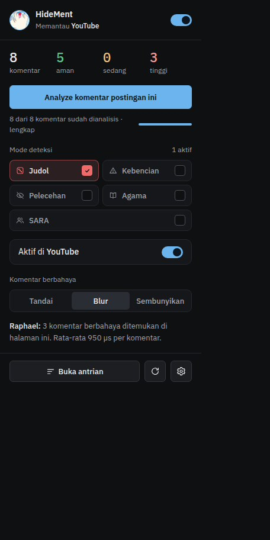
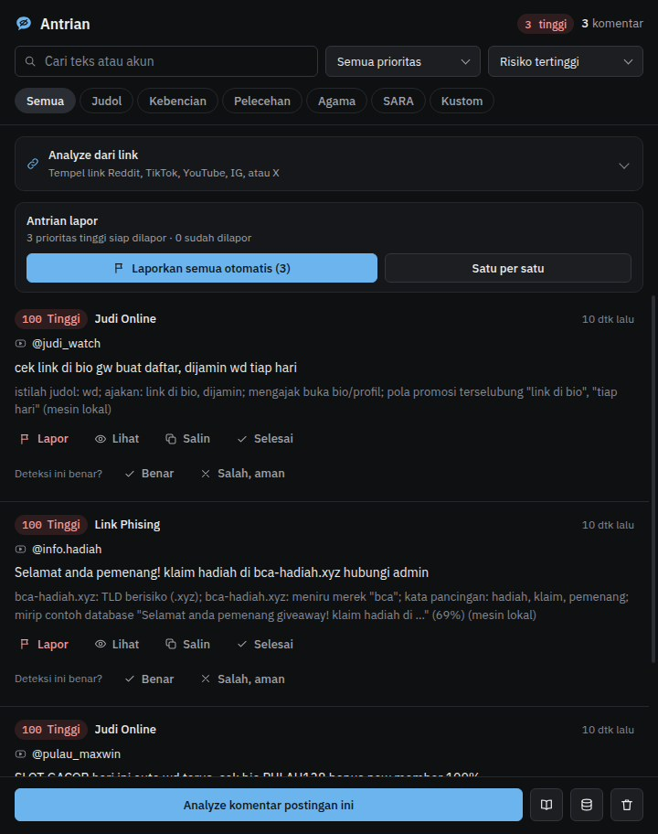
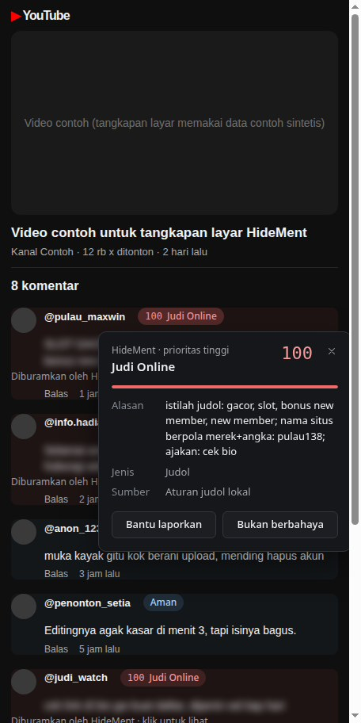
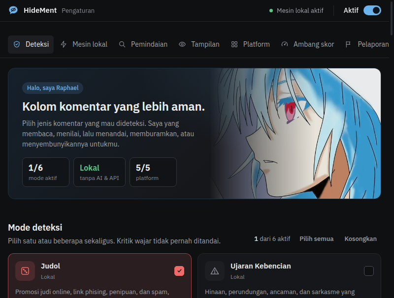

### HideMent
**Hide Comment — sembunyikan komentar berbahaya, biarkan diskusi tetap hidup.**

Ekstensi browser untuk mendeteksi dan menyembunyikan promosi judi online (judol), link phising, ujaran kebencian, pelecehan seksual, penistaan agama, dan SARA berbahasa Indonesia.

`Chrome / Edge (MV3)` · `YouTube` · `Instagram` · `TikTok` · `X` · `Reddit` · `100% lokal, tanpa AI` · `MIT`

<br clear="left"/>

---

> **«Jawaban»** Analisis komentar dimulai. Semua penilaian berjalan di perangkatmu: tanpa model AI, tanpa API key, tanpa internet.
> — *Raphael, sistem analisis HideMent*

## Daftar isi

- [Tentang HideMent](#tentang-hidement)
- [Raphael: sistem di balik HideMent](#raphael-sistem-di-balik-hidement)
- [Fitur](#fitur)
- [Tampilan](#tampilan)
- [Persyaratan](#persyaratan)
- [Instalasi](#instalasi)
- [Konfigurasi](#konfigurasi)
- [Penggunaan](#penggunaan)
- [Privasi & keamanan](#privasi--keamanan)
- [Pengembangan](#pengembangan)
- [Kontribusi](#kontribusi)
- [Riset & evaluasi](#riset--evaluasi)
- [Troubleshooting](#troubleshooting)
- [Roadmap](#roadmap)
- [Kredit & atribusi](#kredit--atribusi)
- [Lisensi](#lisensi)

## Tentang HideMent

Kolom komentar media sosial Indonesia dipenuhi:

- **Promosi judi online** yang disamarkan dengan huruf hias (`𝐒𝐋𝐎𝐓 𝐆𝐀𝐂𝐎𝐑`), nama situs merek+angka (`PULAU138`), atau ajakan "cek bio".
- **Link phising dan penipuan** yang meniru bank, e-wallet, atau platform.
- **Perundungan dan hinaan**, termasuk **sarkasme** yang tidak tertangkap filter kata kasar biasa.

Jumlahnya terlalu banyak untuk diperiksa manual, sementara filter sederhana justru ikut menandai kritik yang wajar.

HideMent **tidak** bertujuan menghapus semua komentar negatif. Tujuannya:

1. **Mengurangi komentar yang benar-benar merugikan** pengguna dan kreator.
2. **Tetap membiarkan kritik normal.** "Editingnya jelek" atau "argumennya lemah" adalah kritik, bukan serangan.
3. **Membantu moderator memprioritaskan** lewat skor risiko 0–100.
4. **Mempermudah pelaporan** dengan saran alasan laporan. Keputusan akhir tetap di tangan manusia.

## Raphael: sistem di balik HideMent

Raphael adalah nama sistem analisis HideMent. Ia yang "berbicara" lewat kotak pesan di popup, Pengaturan, dan Dashboard Antrian. Sejak versi ini Raphael **tidak memakai model AI sama sekali**. Ia adalah *mesin keputusan lokal* yang meniru cara kerja decision model seperti Jev: bukan menghasilkan teks, tapi memberi **keyakinan 0–100 untuk setiap kategori** (setiap kategori diperlakukan sebagai satu pilihan jawaban), lalu kategori dengan keyakinan tertinggi dipakai sebagai hasil dan ambang skor menentukan prioritasnya. Bedanya dengan Jev: semuanya berjalan di browser, **gratis**, dan tidak ada komentar yang dikirim ke server mana pun.

```
Komentar terlihat di layar (atau dimuat oleh Pindai Cepat)
        │
        ▼
Normalisasi teks ─── huruf hias, leetspeak (g4c0r), s p a s i, huruf Kiril tiruan, zero-width,
        │            singkatan chat (yg, gk, bgt), kata ulang angka 2 (rame2 → rame rame)
        ▼
Aturan judol & phising ── judol yang jelas langsung diputuskan (paling cepat)
        │ sisanya
        ▼
Mesin keputusan lokal ── untuk tiap kategori dari mode yang aktif, jumlahkan bukti (log-odds):
        │   1. kamus berbobot + konteks: sasaran orang (lu/kamu/dia/muka), negasi ("kamu gak bodoh"),
        │      kritik konten vs serangan pribadi, kedekatan kata, pujian palsu, peringatan ("hati2, itu judol")
        │   2. Naive Bayes dari contoh berlabel (seed bawaan + contoh belajarmu)
        │   3. contoh belajarmu yang hampir sama → mengikuti labelmu
        ▼
Keyakinan 0–100 per kategori → kategori tertinggi → Badge · highlight · blur · sembunyikan · Antrian
```

**Database contoh (RAG lokal).** Setiap komentar dicarikan 3 contoh berlabel paling mirip dari database `data/seed/*.jsonl` (±520 contoh: pelecehan terselubung, body shaming, dehumanisasi, judol, plus ±180 contoh *aman* yang mirip) ditambah 105 contoh dataset riset dan dari contoh belajarmu. Contoh itu ikut menjadi bukti skor dan dikutip di alasan, mis. *muatan seksual "sejam berapa"; mirip contoh database "sejam berapa ?" (75%)*. Di **Coba mesin** terlihat contoh mana yang paling mirip, jadi setiap keputusan bisa ditelusuri.

Menambah contoh ke database:

1. Tambahkan baris `{"text": "...", "label": "..."}` ke `data/seed/<label>.jsonl` (label: `judol`, `phishing`, `scam`, `spam`, `hinaan`, `perundungan`, `ancaman`, `sarkasme`, `pelecehan`, `penistaan`, `sara`, `aman`).
2. Tambahkan juga contoh *aman* yang mirip tapi wajar (mis. "sewa lapangan sejam berapa?"), supaya mesin tidak asal menandai.
3. `npm run seed` lalu `npm run eval` untuk memastikan akurasi tidak turun. `npm run build` menjalankan `seed` otomatis.

Kenapa cepat & gratis:

- **Tidak ada request jaringan.** Satu komentar dinilai dalam ±0,2 ms (±4.900 komentar/detik di laptop biasa); 300 komentar selesai dalam sekitar 0,1 detik. Badge langsung muncul, tidak ada antrean ke server.
- **"Training" hanya menghitung kata.** Saat kamu menambah contoh, mesin dilatih ulang dalam puluhan milidetik di service worker.
- **Judol yang jelas tetap diputuskan aturan lokal** (mikrodetik), sama seperti sebelumnya.
- **Tidak ada yang dianalisis sebelum kamu menekan Analyze** (bawaan). Mode lain di Pengaturan → Pemindaian: *Saat scroll* (hanya komentar yang terlihat, lewat IntersectionObserver) atau *Pindai cepat* (otomatis tiap postingan dibuka).

Batasannya jujur saja: mesin ini membaca pola kata, bukan "memahami" kalimat seperti model AI. Sindiran yang sangat halus atau konteks yang butuh pengetahuan luar bisa lolos. Untuk itu ada **Contoh belajar**: koreksi yang kamu berikan langsung dipakai.

## Fitur

**Enam mode deteksi**, dipilih lewat checkbox (bawaan hanya Judol yang aktif):

| Mode | Yang dideteksi |
|---|---|
| **Judol** | judi online, link phising, penipuan (hadiah palsu, investasi bodong, pinjol), spam |
| **Ujaran Kebencian** | hinaan, perundungan, ancaman, sarkasme yang merendahkan |
| **Pelecehan Seksual** | komentar cabul/mesum ke seseorang, objektifikasi tubuh, ajakan seksual |
| **Penistaan Agama** | menghina ajaran, kitab suci, nabi/tokoh suci, simbol, atau ibadah suatu agama |
| **SARA** | kebencian/hasutan terhadap kelompok berdasarkan suku, ras, etnis, penganut agama, antargolongan |
| **Kustom** | apa pun yang kamu definisikan sendiri dengan kalimat biasa (mis. spoiler, promosi akun tertentu) |

Semua mode dinilai lokal di browser, tanpa koneksi AI.

**Contoh belajar**: tambahkan komentar berlabel (manual, impor JSON Lines/JSON/CSV, otomatis dari tombol "Bukan berbahaya", atau tombol **Benar / Salah, aman** di Antrian). Mesin lokal langsung mempelajarinya: komentar yang hampir sama (kemiripan trigram & kata, tahan huruf hias, angka pengganti, dan urutan kata yang diacak) mengikuti labelmu, dan pola katanya dipakai Naive Bayes untuk menilai komentar lain. Label buatanmu juga bisa membatalkan putusan aturan judol (mis. komentar yang kamu tandai "Bukan berbahaya").

**Belajar dari link postingan**: tempel link (mis. video TikTok) di Pengaturan → Contoh belajar → *Pelajari komentar dari link*, atau nyalakan *Pelajari komentarnya* di side panel. HideMent membuka tiap postingan, memuat & menganalisis semua komentarnya, lalu menyimpan yang hasilnya **yakin** (prioritas tinggi, dan yang jelas aman; yang ragu dilewati) sebagai contoh bersumber *dari link postingan*. Contoh ini tidak pernah menimpa label yang kamu buat sendiri, dibuang lebih dulu saat daftar penuh, dan bisa dihapus sekaligus (*Hapus dari link*). Input manual juga bisa banyak sekaligus: satu komentar per baris.

**Fitur lainnya:**

- **Jumlah komentar langsung terlihat**: begitu postingan dibuka, popup dan side panel menampilkan total komentar menurut platform (mis. 347 di X) beserta berapa yang sudah aman / sedang / tinggi.
- **Analyze komentar postingan ini**: klik sekali, semua komentar yang sudah dimuat **langsung dinilai saat itu juga**, tanpa halaman digulir otomatis. Komentar yang dimuat platform saat kamu scroll sendiri (mis. balasan X) ikut dinilai begitu muncul. Mau HideMent menggulir sendiri untuk memuat semuanya? Nyalakan Pengaturan → Pemindaian → *Muat semua komentar otomatis* ("Analyze dari link" selalu memuat otomatis). **Setiap komentar diberi label** Aman / Sedang / Tinggi di samping nama akunnya (tidak menambah baris), dan label tetap menempel saat kamu scroll manual (termasuk di X yang membuang & menggambar ulang komentar saat digulir). Sebelum tombol ini ditekan, HideMent tidak mendeteksi apa pun; ubah di Pengaturan → Pemindaian kalau mau otomatis.
- **Analyze dari link**: tempel satu atau banyak link postingan (boleh langsung dari chat WhatsApp). HideMent membukanya satu per satu di satu tab, menganalisis semua komentarnya, dan menampilkan ringkasan per link.
- **Badge + skor risiko** (Tinggi / Sedang) di samping komentar, lengkap dengan alasannya.
- **Tandai, blur, atau sembunyikan**, bisa diatur per kategori. Komentar yang diblur bisa dibuka dengan klik.
- **Dashboard Antrian** di side panel: komentar berbahaya dari semua tab, diurutkan dari risiko tertinggi, bisa difilter, dicari, dan diekspor ke CSV atau **dataset JSONL** (format sama dengan `research/dataset`).
- **Laporkan semua otomatis**: satu klik (plus konfirmasi) dan HideMent melaporkan semua komentar prioritas tinggi satu per satu: membuka menu ⋯, memilih alasan, **menekan Kirim**, lalu menunggu konfirmasi dari platform. Tidak perlu scroll mencari komentarnya; hasilnya muncul sebagai **"Sukses! N komentar berhasil dilaporkan"**. Komentar yang alasannya tidak cocok otomatis **tidak dikirim** dan ditandai *Gagal lapor*; komentar yang kamu tandai *Salah, aman* tidak pernah dilapor. Ada jeda antar laporan dan batas 50 per putaran.
- **Lapor satu per satu** (mode bantu): HideMent mengisi form laporan lalu berhenti di tombol Kirim untuk kamu tekan sendiri.
- **Whitelist** akun tepercaya dan **kata kunci judol kustom**.
- **Tombol "Bukan berbahaya"** untuk mencatat salah deteksi sebagai data riset (bisa diekspor ke JSON).
- **Coba mesin** di Pengaturan: ketik satu komentar dan lihat keyakinan tiap kategori beserta alasannya, langsung.
- **Mode kustom berbasis kata kunci**: tulis kata/frasa yang mau ditandai (dipisah koma), mis. `ending, mati di akhir, pelakunya ternyata` untuk spoiler.

## Tampilan

| Popup | Dashboard Antrian | Overlay di halaman |
|---|---|---|
|  |  |  |



> Tangkapan layar memakai data contoh sintetis.

Gayanya alat utilitas yang tenang: abu netral, satu aksen biru "Tempest" yang dipakai hemat (unsur Rimuru yang halus, bersama logo gelembung berbentuk slime), serta merah dan kuning hanya untuk tingkat bahaya. Huruf memakai IBM Plex Sans & Mono yang dibundel di dalam ekstensi. Overlay di halaman platform memakai font sistem agar tidak ada aset ekstensi yang terekspos ke situs.

Semua kontrol adalah komponen vanilla JS yang bisa dipakai penuh dengan keyboard: saklar (`role="switch"`), dropdown kustom (panah, Home/End, ketik-untuk-mencari), grup pilihan dengan navigasi panah, slider ambang ganda, dan dialog konfirmasi yang mengembalikan fokus. Tata letaknya responsif dari lebar HP (375 px) sampai desktop.

## Persyaratan

| Kebutuhan | Keterangan |
|---|---|
| Browser | Chrome atau Edge **116+** (Manifest V3, side panel) |
| Node.js | **18+** untuk build (diuji dengan Node 26) |

## Instalasi

```bash
git clone https://github.com/MyKineID/HideMent.git
cd HideMent
npm install
npm run build
```

1. Buka `chrome://extensions` (atau `edge://extensions`).
2. Aktifkan **Developer mode**.
3. Klik **Load unpacked**, lalu pilih folder `dist/`.
4. Halaman Pengaturan terbuka otomatis saat pertama kali dipasang.

## Konfigurasi

Semua pengaturan ada di halaman **Pengaturan** (ikon roda gigi di popup). Tidak ada yang perlu dihubungkan: begitu dipasang, semua mode langsung bisa dipakai.

1. **Mode deteksi**: nyalakan mode yang kamu mau (bawaan hanya Judol).
2. **Mesin lokal → Coba mesin**: tempel satu komentar untuk melihat bagaimana Raphael menilainya.
3. **Contoh belajar**: tambahkan contoh kalau ada yang salah deteksi; mesin langsung mempelajarinya.

Pengaturan lanjutan:

| Opsi | Default | Rentang |
|---|---|---|
| Muat semua komentar otomatis | mati | nyala / mati |
| Batas muat otomatis | 300 komentar | 50–2000 |
| Ambang Sedang / Tinggi | 50 / 80 | 10–100 |

Nilai di luar rentang otomatis dikoreksi saat dimuat. Pengaturan koneksi AI dari versi lama (Base URL, API key, model) otomatis dihapus saat pembaruan.

### Akurasi & kecepatan

Diukur dengan `npm run eval` (k-fold: komentar yang dinilai tidak pernah ikut jadi contoh latih) dan `npm run bench`, November 2026. Semua set uji berisi komentar sintetis, jadi angka di kolom komentar sungguhan bisa berbeda.

| Set uji | Komentar | Kategori tepat | Presisi berbahaya | Recall berbahaya | Salah tandai komentar aman |
|---|---|---|---|---|---|
| `blind2.jsonl`: buta, ditulis terpisah, tidak pernah dipakai tuning | 160 | 67,5% | 0,87 | 0,55 | 12,3% |
| ↳ setelah pengaman salah tandai + database contoh (set ini jadi tidak buta lagi) | 160 | 70,6% | 0,93 | 0,57 | 6,2% |
| `blind.jsonl`: buta saat pertama diuji, lalu dipakai tuning | 150 | 72,7% (awal) | 0,95 (awal) | 0,62 (awal) | 5,2% (awal) |
| `sample.jsonl`: dataset riset | 105 | 100% | 1,00 | 1,00 | 0% |

Angka yang paling mewakili adalah baris `blind2.jsonl`. Judol dan phising kuat (F1 kategori ±0,94); ujaran kebencian paling lemah (recall ±0,38) karena hinaan, sarkasme, dan perundungan yang halus butuh pemahaman konteks. Mesin sengaja memilih **jarang salah tandai** daripada menangkap semuanya, sesuai prinsip HideMent. Untuk pola yang sering lolos di komunitasmu, tambahkan contoh belajar; mesin langsung mempelajarinya.

Kecepatan (`npm run bench`, 357 komentar, semua mode aktif termasuk kustom, Node 26 di laptop Windows):

| Mesin | Median | p95 | Komentar/detik |
|---|---|---|---|
| Database bawaan | 0,19 ms | 0,31 ms | ±4.900 |
| + 2.000 contoh belajar | 0,39 ms | 0,59 ms | ±2.500 |

Sebagai pembanding, versi berbasis AI sebelumnya butuh 5,7–10,6 detik sampai semua hasil 20 komentar keluar, dan butuh endpoint serta API key.

## Penggunaan

- **Popup** (klik ikon HideMent): lihat statistik tab, nyalakan/matikan mode, pilih aksi (Tandai / Blur / Sembunyi), jalankan **Pindai semua komentar**, atau buka Dashboard Antrian.
- **Badge** di samping komentar: klik untuk detail alasan, sumber (aturan judol / mesin lokal), tombol **Bantu laporkan**, dan **Bukan berbahaya**.
- **Dashboard Antrian** (side panel): filter per mode (Judol, Kebencian, Pelecehan, Agama, SARA), prioritas, cari teks/akun, **Lihat** untuk melompat ke komentar, **Laporkan semua otomatis** / **Satu per satu**, **Benar / Salah, aman** untuk contoh belajar, **Ekspor CSV** dan **Ekspor dataset (JSONL)**.
- **Analyze dari link** (side panel, bagian atas): tempel link, nyalakan *Langsung laporkan otomatis* kalau mau sekalian dilapor, lalu klik **Analyze N link**.

Alur yang disarankan untuk memperbaiki akurasi:

1. Tempel link postingan di **Analyze dari link** (tanpa lapor otomatis dulu).
2. Cek hasilnya di Antrian: klik **Benar** atau **Salah, aman** per komentar. Keduanya langsung masuk ke contoh belajar dan mesin dilatih ulang.
3. Jalankan ulang analisis; komentar yang mirip sekarang mengikuti contoh tadi.
4. **Ekspor dataset (JSONL)** untuk evaluasi: `npm run eval -- <file>.jsonl`. Baris `perlu_review: true` (belum dicek manusia) otomatis dilewati supaya skor tidak palsu.

## Privasi & keamanan

- **Teks komentar tidak pernah keluar dari perangkatmu.** Semua penilaian berjalan di service worker ekstensi. Tidak ada server HideMent, tidak ada API pihak ketiga, analytics, atau telemetri.
- Tidak ada API key yang disimpan, dan ekstensi tidak lagi meminta izin akses ke host lain (`optional_host_permissions` dihapus); izinnya hanya situs platform yang dipindai.
- Contoh belajar dan catatan "Bukan berbahaya" disimpan di `chrome.storage.local` di perangkatmu.
- Ekstensi **tidak mengekspos aset ke halaman web** (`web_accessible_resources` dihapus), sehingga situs tidak bisa mendeteksi keberadaan HideMent dengan memuat file ekstensi.
- HideMent hanya mengirim laporan sendiri saat kamu menekan **Laporkan semua otomatis** (atau menyalakan *Langsung laporkan otomatis* di Analyze dari link) dan mengonfirmasinya. Laporan dikirim memakai akunmu; platform bisa membatasi akun yang melapor terlalu banyak, jadi cek dulu hasil deteksinya.

## Pengembangan

```bash
npm run dev        # build + watch (reload ekstensi di chrome://extensions setelah perubahan)
npm test           # unit test (Vitest)
npm run typecheck  # TypeScript strict
npm run build      # build produksi ke dist/
npm run check      # typecheck + test + build sekaligus
npm run icons      # buat ulang ikon PNG dari geometri logo
```

Struktur:

| Folder | Isi |
|---|---|
| `src/core/` | normalisasi teks, aturan judol & phising, contoh belajar, pengaturan + validasi |
| `src/core/engine/` | mesin keputusan lokal: kamus berbobot (`lexicon.ts`), fitur & konteks (`features.ts`), Naive Bayes (`bayes.ts`), contoh mirip (`knn.ts`), seed bawaan |
| `src/background/` | service worker: menjalankan mesin lokal, antrian, alur lapor |
| `src/content/` | pemindai komentar per platform, overlay, Pindai Cepat, bantu laporkan |
| `src/content/adapters/` | selektor DOM per platform (YouTube, Instagram, TikTok, X, Reddit) |
| `src/popup/`, `src/options/`, `src/sidepanel/` | antarmuka |
| `src/shared/` | ikon, komponen UI, pesan antar-konteks, suara sistem Raphael |
| `src/styles/theme.css` | token warna & komponen global |
| `scripts/` | build (esbuild), generator ikon, dan `make-seed.mjs` (database `data/seed` + dataset riset → contoh bawaan mesin) |
| `data/seed/` | database contoh berlabel per kategori (JSON Lines) yang dipakai mesin lokal |
| `tests/` | unit test |
| `research/` | dataset, auto-label, evaluasi, benchmark |

Instagram, TikTok, dan Reddit sering mengubah struktur halamannya. Kalau komentar tidak terdeteksi, perbarui selektornya di `src/content/adapters/`.

## Kontribusi

Mau ikut membangun HideMent? Baca [Aturan bersama](docs/prd/kontributor-onboarding.md) (setup, alur Git, definisi selesai), lalu PRD tugasmu:

- [PRD 1: Dukungan Platform Reddit](docs/prd/reddit-platform.md)
- [PRD 2: Data & Akurasi AI](docs/prd/data-akurasi-ai.md)
- [PRD 3: Melengkapi HideMent](docs/prd/melengkapi-hidement.md): CI, test tampilan platform, lapor otomatis per platform (orang pertama); tema terang, ekspor/impor pengaturan, Ollama, rilis Chrome Web Store (orang kedua)
- [PRD 4: Pengecekan YouTube, Instagram, TikTok](docs/prd/pengecekan-3-platform.md): checklist C1–C18 per platform (orang pertama: YouTube & Instagram, orang kedua: TikTok)
- [PRD 5: Sistem Limit Komentar](docs/prd/limit-komentar.md): satu batas komentar per postingan di semua cara pindai, tombol *Baca N lagi*, tetap ringan di thread X yang panjang

## Riset & evaluasi

Folder [`research/`](research) berisi:

- [`labeling-guide.md`](research/labeling-guide.md): definisi tiap label dan batas antara **komentar berbahaya** dan **kritik wajar**.
- [`dataset/sample.jsonl`](research/dataset/sample.jsonl): **105 komentar contoh** sintetis berlabel kategori dan sentimen.
- `label.ts`: auto-label komentar mentah dengan mesin lokal; semua baris ditandai `perlu_review` dan yang paling ragu ditaruh paling atas.
- `eval.ts`: precision, recall, F1 per kategori dan false positive pada komentar aman. Pakai k-fold: komentar yang dinilai tidak pernah ikut jadi contoh latih.
- `bench.ts`: kecepatan mesin (median, p95, komentar/detik), dengan dan tanpa 2.000 contoh belajar.
- `dataset/holdout.jsonl`, `dataset/blind.jsonl`, `dataset/blind2.jsonl`: set uji tambahan (lihat bagian Akurasi & kecepatan).

```bash
npm run eval                                   # dataset riset (research/dataset/sample.jsonl)
npm run eval -- research/dataset/blind2.jsonl  # set uji lain
npm run bench
npm run label -- research/raw/contoh-komentar.txt
npm run seed                                   # kompilasi data/seed/*.jsonl + dataset riset jadi contoh bawaan mesin
```

Temuan awal: sebagian besar komentar judol/phising justru **bernada positif** ("alhamdulillah wd terus"), sementara banyak komentar aman **bernada negatif** (kritik). Karena itu HideMent mengklasifikasikan **niat dan dampak**, bukan nada.

## Troubleshooting

| Gejala | Solusi |
|---|---|
| Badge tidak muncul setelah ekstensi di-reload | Refresh tab (F5). HideMent juga mencoba memasang ulang content script otomatis. |
| Komentar Instagram/TikTok tidak terdeteksi | Struktur halaman berubah; perbarui selektor di `src/content/adapters/`. |
| Komentar Reddit tidak terdeteksi | Reddit punya dua DOM: baru (`www.`/`sh.reddit.com`, web component `shreddit-*`) dan lama (`old.reddit.com`). Adapter mendukung keduanya. Kalau masih kosong, refresh tab setelah reload ekstensi. |
| Di X "0 dipindai" / jumlah komentar kosong | X sedang memakai dua versi DOM (dengan dan tanpa `data-testid`); adapter X mendukung keduanya. Kalau masih kosong, refresh tab setelah reload ekstensi. |
| TikTok berhenti di ±20 komentar | TikTok hanya memberi halaman pertama ke pengunjung yang belum login. Login dulu, lalu Analyze lagi. |
| Hanya judol yang terdeteksi | Mode lain belum dinyalakan. Aktifkan di popup atau Pengaturan → Mode deteksi. |
| Komentar tertentu salah dinilai | Tambahkan sebagai contoh di Pengaturan → Contoh belajar (atau klik **Bukan berbahaya** / **Benar / Salah, aman**). Cek hasilnya di **Coba mesin**. |
| Hasil lama masih tampil setelah menambah contoh | Klik ikon pindai ulang di popup (komentar yang sudah diberi label tidak dinilai ulang otomatis). |

## Roadmap

- [ ] Light theme mengikuti tema sistem.
- [ ] Ekspor/impor pengaturan.
- [ ] Dukungan Firefox (MV3).
- [x] Adapter Reddit ([PRD](docs/prd/reddit-platform.md)) — mendukung Reddit baru (`www.`/`sh.`) dan `old.reddit.com`.
- [ ] Adapter platform tambahan: Facebook, Threads.
- [ ] Memperbesar dataset dengan komentar nyata yang sudah dianonimkan.
- [x] Mesin keputusan lokal tanpa AI untuk semua mode (gratis, tanpa API key).
- [ ] Perluas kamus & seed dengan komentar nyata yang sudah dianonimkan.

## Perubahan dari Tempest

HideMent adalah pengembangan lanjutan dari [Tempest](https://github.com/MyKineID/tempest). Perubahan utama:

- **Identitas baru**: nama, logo, ikon, dan antarmuka yang dirancang ulang (tenang & bersih, menggantikan gaya 8-bit), dengan komponen vanilla JS yang aksesibel dan responsif.
- **Deteksi lokal ±3× lebih cepat**: regex istilah judol kini dikompilasi sekali, bukan per komentar. Diukur pada 105 komentar dataset: median ~117 µs → ~35 µs per komentar, dengan hasil identik di 333 kasus uji pembanding.
- **Lebih sedikit false positive phising**: merek pendek (`bri`, `bca`, `ovo`, `dana`, …) tidak lagi dicocokkan sebagai potongan kata, jadi `library.xyz` atau `danamon` tidak dianggap meniru bank, sementara `klikbca-secure.com` dan `danakaget.site` tetap tertangkap.
- **Validasi pengaturan & Base URL** dengan pesan galat yang jelas.
- **Penulisan feedback berurutan** agar klik "Bukan berbahaya" beruntun tidak saling menimpa.
- **Font baru**: 5 font pixel diganti IBM Plex (subset latin, 5 bobot, ±100 KB). Total `dist/` kini ±298 KB (Tempest: 223,6 KB); selisihnya hampir seluruhnya dari font.
- **Permukaan serang lebih kecil**: aset ekstensi tidak lagi diekspos ke semua situs.
- **Test bertambah** dari 56 menjadi 66.

## Kredit & atribusi

- HideMent dikembangkan dari **[Tempest](https://github.com/MyKineID/tempest)** oleh MyKineID, berlisensi MIT.
- Nama sistem **Raphael** dan nuansa warnanya terinspirasi *Tensei Shitara Slime Datta Ken* (Rimuru Tempest). Ini proyek penggemar yang independen dan tidak berafiliasi dengan pemegang hak cipta karya tersebut.
- Ilustrasi Raphael di README digambar sendiri oleh pembuat proyek.

## Lisensi

[MIT](LICENSE) © 2026 MyKineID. Bebas dipakai, dimodifikasi, dan dikembangkan, dengan menyertakan pemberitahuan hak cipta dan lisensi.
